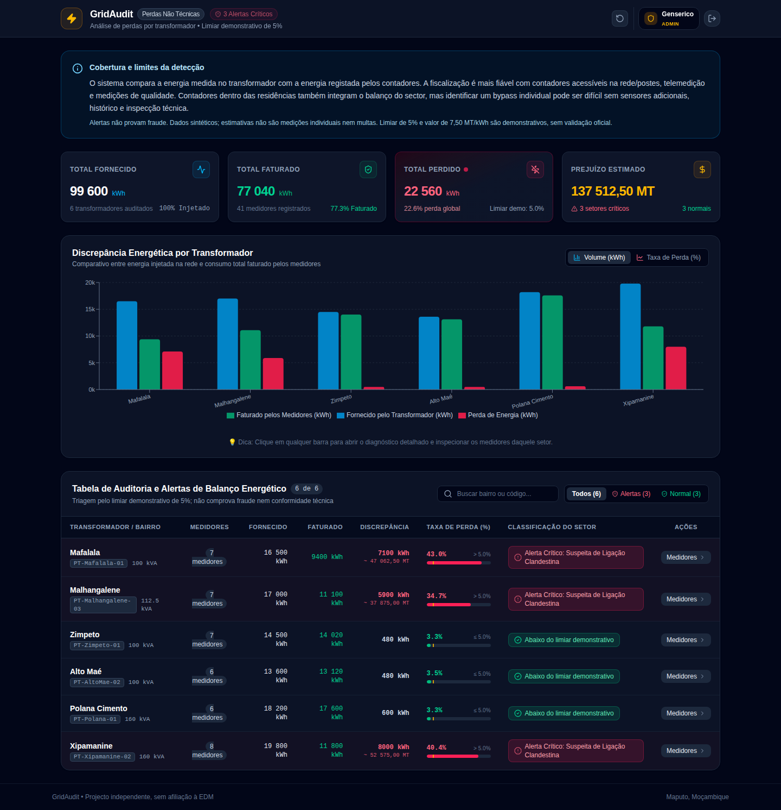

# GridAudit — Auditoria de discrepâncias de energia

Projecto independente, sem afiliação à EDM. Protótipo full-stack para comparar energia
fornecida e faturada por transformador, organizar indícios e apoiar investigação técnica.
Um alerta não comprova fraude. Não aplica multas. A demonstração usa dados sintéticos;
5% e 7,50 MT/kWh são parâmetros demonstrativos, sem validação oficial.

**Para recrutadores:** [tour da interface e evidência técnica](docs/SHOWCASE.md) ·
[contribuir](CONTRIBUTING.md) · [progresso e limites](docs/roadmap-execucao.md).

Competências demonstradas: React/TypeScript, API Java/Spring, autenticação JWT/RBAC,
PostgreSQL/Flyway, testes concorrentes com Testcontainers e E2E com Playwright.
As melhorias desta branch estão propostas em PRs dependentes; não estão integradas em
`main`. O roadmap completo e a prontidão para produção permanecem em desenvolvimento.



## English overview

Independent full-stack energy-discrepancy auditing prototype, not affiliated with EDM.
It compares supplied and billed energy per transformer, displays readings and preliminary
inspection records through the API, and offers a browser dashboard and demonstration PDF.
Alerts are indicators requiring technical investigation, not proof of fraud. No automatic fines.
All showcase data is synthetic; thresholds and monetary values are illustrative.

Explore the [screenshots and engineering evidence](docs/SHOWCASE.md). This branch contains
proposed changes awaiting human review; it is not a production-readiness claim.

## Arquitetura

```
projeto/
├── backend-spring-boot/     Java 17 + Spring Boot 3.2 — API REST + motor de cálculo
│   └── H2 em memória (arranca já com dados de demonstração de Maputo)
└── src/                     React 19 + TypeScript + Vite — Dashboard
```

O frontend comunica com o backend via `/api/*`, encaminhado pelo proxy do Vite para
`http://localhost:8080` durante o desenvolvimento — não há problemas de CORS a configurar.

## Pré-requisitos

- **Java 17** ou superior (para o backend)
- **Node.js 20** e **npm** (versão usada pela CI)
- **Maven** instalado (não existe Maven Wrapper neste repositório)
- **Docker** para PostgreSQL e testes Testcontainers

## Como correr — Backend (Spring Boot)

Antes de usar qualquer opção, configure as variáveis da secção
[Configuração segura de acesso](#configuração-segura-de-acesso). No IntelliJ,
adicione-as à configuração de execução. Sem elas, o arranque é recusado.

### Opção A — IntelliJ IDEA (recomendado para a apresentação)

1. Abrir a pasta `backend-spring-boot/` como projeto Maven no IntelliJ
2. Aguardar o IntelliJ resolver as dependências (primeira vez pode demorar)
3. Correr a classe `EnergyTheftDetectionApplication.java` (botão ▶ verde)
4. Confirmar no terminal do IntelliJ que aparece: `Tomcat started on port 8080`

### Opção B — Terminal

```bash
cd backend-spring-boot
mvn spring-boot:run
```

O backend arranca em **http://localhost:8080**, com a base de dados H2 em memória já
populada com 6 transformadores e ~41 medidores de bairros reais de Maputo (Zimpeto,
Xipamanine, Mafalala, etc.) — ver `DataSeeder.java`.

A consola H2 está desactivada por defeito; para depuração local, configure `H2_CONSOLE_ENABLED=true` e visite `http://localhost:8080/h2-console` apenas na máquina de desenvolvimento.

## Como correr — Frontend (React)

Num segundo terminal, a partir da raiz do projeto:

```bash
npm ci
npm run dev
```

O frontend arranca em **http://localhost:3000** (ou a porta seguinte livre, o Vite indica no terminal).

**Importante:** o backend tem de estar a correr primeiro, senão o dashboard mostra o ecrã
de erro de ligação ("Não foi possível contactar o servidor").

## Configuração segura de acesso

O backend utiliza JWT e BCrypt. As passwords **não são incluídas no repositório**.
Antes de iniciar o backend, configure estas variáveis de ambiente:

| Variável | Finalidade |
|---|---|
| `EDM_GENSERICO_PASSWORD` | Password individual de `genserico` (ADMIN) |
| `EDM_OXIDIA_PASSWORD` | Password individual de `oxidia` (ADMIN) |
| `EDM_LEYSA_PASSWORD` | Password individual de `leysa` (OPERATOR) |
| `EDM_HELEN_PASSWORD` | Password individual de `helen` (OPERATOR) |
| `JWT_SECRET` | Segredo aleatório com pelo menos 32 bytes para assinatura HS256 |
| `EDM_CORS_ORIGIN` | Origem permitida do frontend (por defeito `http://localhost:3000`) |
| `H2_CONSOLE_ENABLED` | `true` somente quando for preciso depurar localmente (por defeito `false`) |

Exemplo em Linux/macOS:

```bash
export EDM_GENSERICO_PASSWORD="$(openssl rand -hex 24)"
export EDM_OXIDIA_PASSWORD="$(openssl rand -hex 24)"
export EDM_LEYSA_PASSWORD="$(openssl rand -hex 24)"
export EDM_HELEN_PASSWORD="$(openssl rand -hex 24)"
export JWT_SECRET="$(openssl rand -hex 32)"
cd backend-spring-boot
mvn spring-boot:run
```

No PowerShell, defina os mesmos valores em `$env:EDM_GENSERICO_PASSWORD`, `$env:EDM_OXIDIA_PASSWORD`, `$env:EDM_LEYSA_PASSWORD`, `$env:EDM_HELEN_PASSWORD` e `$env:JWT_SECRET` antes de executar Maven. Não coloque valores reais em ficheiros versionados.

Cada password deve ser diferente, ter pelo menos 12 caracteres e no máximo 72 bytes UTF-8. As antigas variáveis por papel deixam de ser aceites; é necessário configurar as quatro variáveis individuais antes de actualizar. Os exemplos geram valores novos a cada execução.

**Utilizadores de demonstração:** `genserico` e `oxidia` (ADMIN), `leysa` e `helen` (OPERATOR). Estes nomes não são contas de produção. O acesso rápido com passwords embutidas foi removido.

As credenciais anteriormente publicadas devem ser consideradas comprometidas e substituídas. Se o sistema já esteve acessível a terceiros, substitua também o segredo JWT e invalide sessões anteriores.

## Funcionalidades disponíveis

- Dashboard com resumo agregado (energia fornecida, faturada, perdida, alertas críticos)
- Gráfico comparativo de discrepância por transformador
- Tabela de auditoria com filtro por status (crítico/normal) e busca
- Detalhe por transformador: cálculo individualizado de perda pro-rata por medidor,
  com diagnóstico de suspeita (`Suspeita de Bypass`, `Consumo Elevado`, `Regular`)
- Exportação de relatório de auditoria em PDF por transformador
- Simulação de discrepâncias e regularização de setor (apenas ADMIN + perfil `demo`) — chama o
  backend real, que recalcula o balanço energético

## Limitações conhecidas (próximos passos)

- **Cadastro de novo transformador/setor** e **cadastro de novo medidor** ainda não têm
  endpoint no backend (`POST /api/energy/transformers` e `POST /api/energy/transformers/{id}/meters`
  não existem em `EnergyController.java`). Os formulários correspondentes foram removidos
  do frontend por esse motivo, para não simular funcionalidade que não persiste.
- No perfil H2 os dados voltam ao estado inicial (`DataSeeder.java`) quando o backend
  reinicia. O perfil PostgreSQL mantém dados e contas entre reinícios.
- As contas iniciais são criadas com hash BCrypt em `app_user` apenas quando a tabela
  está vazia; reinícios não reescrevem credenciais. As passwords do primeiro arranque
  devem vir de um cofre de segredos em produção.

## Stack técnica

**Backend:** Java 17, Spring Boot 3.2, Spring Security, JWT (JJWT 0.12.6), BCrypt, H2, Lombok, Maven
**Frontend:** React 19, TypeScript, Vite, Tailwind CSS, Recharts, jsPDF

## Smart Metering — fase inicial

A base de dados distingue a localização física dos contadores: `POLE` (poste), `INSIDE_HOME` (interior da residência), `OUTSIDE_HOME` (exterior) ou `UNKNOWN` (não confirmado). O campo `remoteReadingEnabled` indica disponibilidade de telemedição, sem assumir que existe integração real.

Uma tabela `meter_readings` guarda leituras históricas com data, energia em kWh e origem. A API disponibiliza:

- `GET /api/energy/meters/{meterId}/readings`: consulta as últimas 100 leituras, para utilizadores autenticados.
- `POST /api/energy/meters/{meterId}/readings`: entrada **manual**, exclusiva a ADMIN, com JSON `{"recordedAt":"2026-10-12T07:00:00Z","energyKwh":125.5}`.

Nesta fase, os registos têm origem `MANUAL`. Ainda não existe integração com hardware, protocolo AMI, leitura automática ou validação metrológica. A base H2 continua a ser volátil: os históricos desaparecem quando se reinicia a aplicação.

**Importante:** variações de consumo e discrepâncias por transformador são indícios para investigação. A posição do contador e a análise estatística não comprovam que houve bypass ou fraude; é indispensável confirmação técnica. O limiar de 5% e a tarifa de 7,50 MT/kWh são valores de demonstração, não parâmetros oficiais validados.

Os testes de compilação e de API executam automaticamente no GitHub Actions após alterações e diariamente por agendamento; a confirmação deve ser feita no separador Actions do repositório.

## PostgreSQL persistente (desenvolvimento local)

O H2 continua a ser o perfil de demonstração por defeito. Para guardar os dados após reiniciar o servidor, utilizar PostgreSQL 16 com Docker.

1. Ter Docker Desktop instalado e iniciado. Criar um ficheiro `.env` **local** na raiz com `DB_PASSWORD` definido com valor privado forte (não publicar o ficheiro).
2. Na raiz do repositório executar `docker compose up -d postgres`.
3. No PowerShell, definir `$env:SPRING_PROFILES_ACTIVE="postgres"`, `$env:DB_PASSWORD="<a mesma password configurada no .env>"` (substituindo pelo valor local), além de as quatro passwords individuais da tabela acima e `JWT_SECRET`.
4. Executar `cd backend-spring-boot` e `mvn spring-boot:run`.
5. Reiniciar o backend e consultar novamente `GET /api/energy/meters/{meterId}/readings` para confirmar a persistência.

A configuração está em `application-postgres.properties`. Os dados ficam no volume Docker `gridaudit_pgdata`, que sobrevive a `docker compose down` (mas **não** a `docker compose down -v`).

**Migrações:** PostgreSQL usa Flyway V1–V3 e `hibernate.ddl-auto=validate`. Bases antigas não vazias e sem histórico Flyway são recusadas; é necessária adopção revista numa cópia restaurada, conforme [runbook](docs/runbooks/postgres-migrations.md). Nunca activar baseline automático para contornar esse erro. Contas e dados demonstrativos do DataSeeder não são dados reais de clientes EDM.

## Roadmap e segurança

O [roadmap de conclusão](ROADMAP.md) define as fases restantes. Consultar o [registo de execução](docs/roadmap-execucao.md) para distinguir o que foi implementado das pendências e o [SECURITY.md](SECURITY.md) para os limites do protótipo.

Os comandos de simulação exigem agora o perfil `demo`; nunca o activar com dados reais. A sessão do navegador não é persistida: recarregar a página ou expirar o token (15 minutos) exige novo login. O login está limitado a 10 pedidos/minuto por IP e por instância; cinco falhas consecutivas bloqueiam a conta durante 15 minutos. Alterar `auth_version` invalida imediatamente os tokens anteriores da conta.

Para contribuir, consulte [CONTRIBUTING.md](CONTRIBUTING.md) (português / English).
