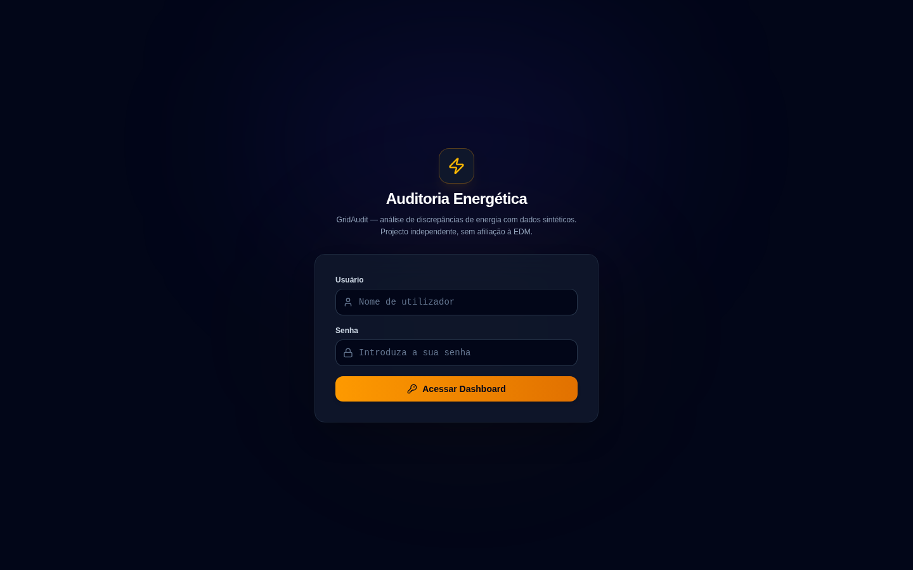
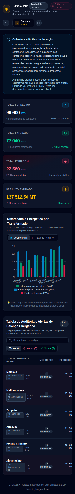
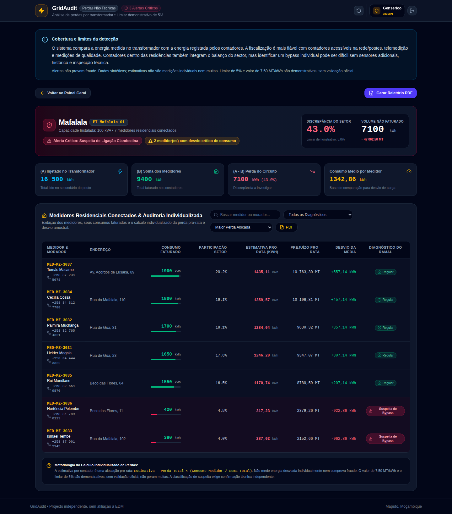

# GridAudit — tour para recrutadores / recruiter tour

Projecto independente, sem afiliação à EDM. Protótipo em evolução; dados sintéticos.
O objectivo é apoiar investigação de discrepâncias de energia, nunca acusar clientes
ou aplicar multas automaticamente. Estimativas pro-rata não são medições individuais.

## Interface real

As imagens são capturas Playwright da aplicação React ligada à API Spring e PostgreSQL,
não mockups. As capacidades abaixo já existem nesta branch, proposta no PR #7.

### Login

Sessão com JWT em memória no navegador. Contas BCrypt persistentes e bloqueio por falhas.

### Dashboard desktop

Balanço fornecido/faturado, gráfico e tabela pesquisável. O limiar é demonstrativo.

### Dashboard mobile

Layout adaptado a viewport mobile; tabelas largas têm deslocamento horizontal.

### Detalhe do transformador

Contadores, pesquisa, triagem e exportação PDF demonstrativa. Simulação só para ADMIN
quando o perfil demo está activo; fica escondida nesta captura sem esse perfil.

## Como avaliar

1. Seguir o [README](../README.md) para Java 17, Node 20, Maven, passwords próprias e PostgreSQL.
2. Executar `mvn -B verify -f backend-spring-boot/pom.xml` com Docker disponível.
3. Executar `npm ci` e `npm run build`.
4. Consultar o [workflow visual](../.github/workflows/visual-postgres.yml): arranque,
   login, persistência após reinício, screenshots e download PDF são verificáveis.

Não há URL de produção nem credenciais públicas de acesso. A aplicação local e os
artefactos da CI permitem avaliar as funcionalidades sem dados de clientes reais.

## English

These are real browser captures of the React UI connected to Spring and PostgreSQL,
using synthetic fixtures. The project demonstrates typed frontend development, REST APIs,
JWT/RBAC, versioned migrations, concurrent database tests and reproducible browser checks.
The dashboard, transformer drill-down and demonstration PDF are implemented. Account
administration, MFA, refresh, full case workflow, offline PWA and production operations
remain roadmap items. Human review is required before merging dependent PRs.

## Proveniência / provenance

Capturas de 15/10/2026, código funcional `0d7f32b1fe2d46af9850580220795f895126f8ee`, workflow
[38782377939](https://github.com/Genseric0/edm-energy-fraud-detector/actions/runs/38782377939).
Viewports: desktop 1440×900, mobile 390×844; full-page. Dados sintéticos do seed
e do teste de persistência. As capturas ficam versionadas aqui para não dependerem
da retenção temporária dos artefactos da CI.
